# 面向特定领域的 Java 文件级代码合成与 7B 模型监督微调

## 摘要

企业信息化、智慧物流和智慧城市的软件开发依赖各自的业务对象、接口约定与状态规则，通用代码模型的局部补全能力尚不足以保证完整文件的工程可用性。本文研究面向特定领域的 Java 文件级代码合成：以自然语言行为需求和目标文件骨架为条件，生成能够回填既有工程的完整源码。以 AiXcoder 7B V2 为基础，本文从真实领域仓库提取源码、结构信息与关联测试，利用 GPT 6 Luna 生成细化行为需求，构建源码驱动的监督样本，并采用仅对目标源码计算损失的全参数监督微调方法。在三个领域共 220 个文件的配对功能评测中，领域微调预测的样本通过率为 76.82%，基础预测为 19.09%；131 个原失败文件转为通过。分阶段评测与实现对照表明，主要改善集中于文件结构、成员实现和接口约束；长度分层则显示，规模较大的目标文件仍具有较低通过率。实验结果说明，领域源码监督、显式结构条件与可执行测试能够共同支持特定业务环境下的文件级代码合成。

**代码仓库：[https://github.com/stq1234/LLMandAppliedPractices-Domain-Code-SFT](https://github.com/stq1234/LLMandAppliedPractices-Domain-Code-SFT)。本次实验的代码及相关说明可在该仓库中获取。**

## 1 引言

### 1.1 领域软件开发中的文件级代码合成

代码生成模型在实际软件开发中的应用，需要同时满足程序语言规则、工程依赖和业务语义。与相对独立的算法函数相比，领域软件中的一个 Java 文件通常承担明确的工程职责，其实现依赖仓库已有类型、第三方应用程序编程接口（application programming interface，API）及跨方法共享的状态。即使局部语句符合语法，错误的接口重载、状态更新顺序或边界条件仍可能导致整个文件无法编译或未能通过行为测试。CoderEval 等研究通过真实仓库中的上下文依赖任务说明，独立函数生成的评价结果不足以完整反映模型在工程环境中的代码生成能力。[[2]](https://arxiv.org/abs/2302.00288)

面向特定领域的代码合成进一步涉及业务概念与实现惯例的适配。企业信息化中的事件分发、服务调用和权限流程，智慧物流中的运输订单、路线分配与设备状态，以及智慧城市中的空间对象和设备属性，虽然采用相同的 Java 语法，却具有不同的数据对象、接口组合和操作约束。领域适配的目标因此包含两个层次：一是生成满足工程类型与依赖约束的代码，二是正确实现特定业务环境下的行为规则。

本文将研究对象限定为既有工程中的 Java 文件级代码合成。任务输入由中文行为需求与目标文件骨架组成，输出为完整 Java 源文件。骨架保留类型、成员和方法签名，用于确定实现的结构边界；需求描述返回值、调用顺序、状态变化和异常行为，用于约束实现语义。生成文件回填原工程后，通过关联测试检查其集成与功能表现。文件级任务要求多个方法、构造器和成员之间保持一致，因而同时涉及局部实现与文件内部的协同关系。

### 1.2 代码补全模型的任务适配

AiXcoder 7B 及 AiXcoder 7B V2 主要面向代码补全（code completion），通过程序前后文和仓库上下文预测待补代码。[[3]](https://arxiv.org/abs/2410.13187) [[4]](https://arxiv.org/abs/2503.15301) 本文任务在输入条件与输出范围上有所扩展：输入包含自然语言需求及结构信息，输出覆盖完整文件中的多个实现单元。模型需要建立行为描述、类型约束与源码之间的对应关系，并在较长生成过程中保持这种关系。

为适配上述任务，本文采用监督微调（supervised fine-tuning，SFT），以“细化需求、文件骨架、完整实现”构成训练样本。真实源码提供实现目标，结构解析提供骨架，大模型根据参考实现生成需求描述。该构造方式使行为条件与监督答案具有明确对应关系。功能评测则将生成文件置于原工程中运行关联测试，从而评价其在所选工程约束下的可用性。

### 1.3 研究问题

本文围绕以下三个问题展开：

1. 如何将领域仓库中的源码、类型结构、测试与大模型生成需求组织为一致的文件级监督样本？
2. 如何通过输入组织、源码监督目标和长序列训练，对 7B 代码补全模型进行文件合成任务适配？
3. 在相同目标文件与测试约束下，领域微调预测相较基础预测的差异主要体现在哪些失败阶段和实现行为上？

第 2 节介绍相关研究，第 3 节定义任务并说明模型基础，第 4 至第 6 节分别介绍数据构造、监督微调与功能评测设置，第 7 节通过整体指标、错误分布及配对案例分析实验结果，第 8 节讨论结果的机制解释与适用范围。完整训练配置、需求生成提示和扩展案例列于附录。

## 2 相关工作

### 2.1 领域适配与工程代码生成

领域适配研究关注通用预训练分布与目标任务分布之间的差异。Gururangan 等在多个自然语言领域和分类任务上研究了领域自适应预训练与任务自适应预训练，表明进一步利用目标领域或任务语料可以改善相应任务表现。[[1]](https://aclanthology.org/2020.acl-main.740/) 这一研究为目标分布适配提供了方法背景。本文采用的具体途径是源码条件生成的监督微调，利用领域实现中的类型使用、接口组合和行为模式组织监督信号。

工程代码生成还需要考虑输出与周边软件环境之间的关系。CoderEval 从真实开源项目构造 Java 与 Python 生成任务，并按上下文依赖程度组织评价，涵盖类、文件、项目和第三方库中的程序元素。其结果表明，依赖外部上下文的代码生成具有明显挑战。[[2]](https://arxiv.org/abs/2302.00288) 本文将输出单元扩展为完整 Java 文件，并保留其原工程环境，以关联测试检查文件实现是否满足相应的构建与行为约束。

本文中的“领域”指企业信息化、智慧物流和智慧城市等应用领域。领域差异主要体现为业务对象、状态规则与接口使用方式。Java 文件骨架承担结构条件的作用，自然语言需求承担行为条件的作用，二者共同限定文件合成任务。

### 2.2 AiXcoder 7B：面向工程代码补全的语言模型

AiXcoder 7B 属于约 70 亿参数量级的代码语言模型，其设计目标是在补全质量与推理效率之间取得平衡，支持开发过程中的源码续写、中间填充和跨文件代码补全。其训练设计包含高质量代码数据处理、面向文件关系的采样和多目标预训练。原论文报告使用 1.2 万亿个独立词元（token）进行预训练，并结合内容相似性、路径关系及依赖关系组织跨文件样本。[[3]](https://arxiv.org/abs/2410.13187)

模型训练包含下一词元预测、中间填充和结构化中间填充等目标。下一词元预测用于学习从左到右的源码生成分布；中间填充（fill-in-the-middle，FIM）通过序列重排，将待补片段置于前后文之后，使因果语言模型能够在生成时同时利用片段两侧的信息；结构化中间填充进一步依据语法结构选择待补单元。FIM 的通用训练机制由 Bavarian 等进行了系统研究。[[5]](https://arxiv.org/abs/2207.14255) 这些训练目标共同支持模型处理续写、局部修改和结构单元补全等开发情境。

本文采用该模型系列的源码生成接口，将需求与骨架组织为条件序列，以完整源码作为响应。任务适配保留补全模型的自回归生成机制，通过文件级监督学习建立自然语言行为条件与完整实现之间的映射。

### 2.3 AiXcoder 7B V2：仓库长上下文的有效利用

AiXcoder 7B V2 进一步关注仓库级代码补全中的长上下文利用问题。代码模型即使接收到相关接口或相似实现，也可能过度依赖待补位置邻近的文本，未能充分利用较远的工程信息。该工作提出面向代码上下文利用的 CoLT 训练方法，构造覆盖四种语言的训练数据集 CoLT-132K，并结合监督微调与直接偏好优化（direct preference optimization，DPO）训练模型。偏好训练以正确源码为优选响应，以模型采样产生的错误补全为对照响应；上下文组织则压缩依赖实现并保留接口信息。[[4]](https://arxiv.org/abs/2503.15301)

表 1 列出原论文报告的 Java 补全结果。AiXcoder 7B V2 在 API 调用、单行补全和结构片段补全上的精确匹配率均高于初始版本，其中结构片段补全由 50.6% 提高至 60.9%。这些结果表明，该版本在原论文设定下具有更强的上下文补全能力，为本文选择基础模型提供了依据。本文在已发布模型之上进一步开展领域文件级监督微调，以适配从需求与结构条件生成完整文件的任务。

**表 1  AiXcoder 系列原论文报告的 Java 补全结果（精确匹配率，%）**

| 文献评测任务 | AiXcoder 7B | AiXcoder 7B V2 |
|---|---:|---:|
| CoLT-132K：API 调用 | 73.3 | 78.5 |
| CoLT-132K：单行补全 | 87.1 | 88.7 |
| CoLT-132K：结构片段 | 50.6 | 60.9 |
| CrossCodeEval：Java | 42.50 | 51.43 |

表中数值均来自原论文。[[4]](https://arxiv.org/abs/2503.15301) 本文实验采用原工程关联测试评价文件功能，其样本范围与指标定义不同于上述补全任务，因此两类数值不作直接比较。

### 2.4 仓库上下文与源码驱动的监督数据

RepoCoder 将检索与生成迭代结合，利用已生成代码改进后续相关代码检索；CrossCodeEval 通过静态分析构造依赖跨文件信息的补全任务。两项研究分别从上下文获取和上下文依赖评价的角度，说明仓库信息在工程代码生成中的作用。[[6]](https://aclanthology.org/2023.emnlp-main.151/) [[7]](https://arxiv.org/abs/2310.11248) 本文同样从仓库中提取结构与依赖信息，并根据需求生成和源码生成两个阶段的用途组织模型可见上下文。

源码驱动的数据合成利用真实程序作为任务构造的起点。Magicoder 的 OSS-Instruct 以开源代码片段启发大模型生成指令数据，增强合成任务与实际程序的联系。[[8]](https://proceedings.mlr.press/v235/wei24h.html) 本文采用约束更明确的需求生成方式：向需求生成模型提供目标完整源码及结构上下文，要求其描述已有实现的行为，并保留原始源码作为监督答案。由此形成的训练对用于学习细化行为需求下的文件实现能力。

### 2.5 输出粒度、工程上下文与本文定位

代码生成任务需要同时按输出单元和上下文范围加以区分。函数级任务通常补充一个函数或方法，类级任务需要协调多个成员，文件级任务还涉及包声明、导入、类型定义及文件内的完整实现。仓库上下文则描述生成所依赖的信息范围：即使只生成几行代码，也可能必须引用其他文件中的接口。因此，输出更长与依赖更广属于不同维度。

ClassEval 通过包含相互依赖方法的 Python 类级任务研究这一差异，其评测显示，方法级生成能力不能直接等同于类级生成能力。[[15]](https://mingwei-liu.github.io/assets/pdf/ICSE2024ClassEval-V2.pdf) 本文同样关注多个实现单元之间的一致性，但目标是三个应用领域真实仓库中的 Java 源文件，并通过文件回填与原工程测试评价生成结果。表 2 对相关任务的侧重点进行比较。

**表 2  相关代码生成任务与本文任务的定位**

| 工作或任务 | 主要输出单元 | 条件信息与依赖范围 | 评价关注点 |
|---|---|---|---|
| CoderEval [[2]](https://arxiv.org/abs/2302.00288) | 真实项目中的函数或方法 | 自然语言描述及项目依赖，覆盖不同上下文依赖层次 | 生成实现的功能正确性 |
| CrossCodeEval [[7]](https://arxiv.org/abs/2310.11248) | 需要跨文件信息的补全片段 | 当前文件上下文与其他文件中的相关程序元素 | 跨文件上下文对补全结果的作用 |
| ClassEval [[15]](https://mingwei-liu.github.io/assets/pdf/ICSE2024ClassEval-V2.pdf) | 包含多个相关成员的 Python 类 | 类级需求、成员说明及方法间依赖 | 类及其相互依赖方法的实现正确性 |
| 本文领域文件合成 | 完整 Java 源文件 | 中文行为需求、目标骨架及文件元信息，依赖原仓库集成环境 | 文件提取、工程约束和关联测试共同限定的通过情况 |

本文的领域适配体现为监督数据的来源及其行为约束：仓库提供领域对象与接口使用方式，源码驱动需求描述这些对象的具体操作规则，文件级训练学习在给定结构中实现这些规则。评测以目标文件为单位，不将局部补全精度、参考文本相似度与文件功能通过率混为同一指标。

## 3 背景知识与任务形式化

### 3.1 文件合成任务

设输入为 \(x=(r,s,m)\)，其中 \(r\) 为中文行为需求，\(s\) 为目标文件骨架，\(m\) 为目标路径和编程语言等文件元信息。模型生成完整源码 \(y\)，评测器将其回填工程目标路径，并运行关联测试命令集合 \(\mathcal C\)。学习目标是提高满足行为需求与工程约束的源码条件概率；功能评价则检验回填后的文件能否通过相应构建与行为检查。本文的源码生成提示以需求和目标骨架为主，需求生成阶段使用的完整依赖骨架集合不作为额外输入提供给源码生成模型。

骨架、需求与工程环境分别约束输出的不同方面。骨架限定类、字段、构造器和方法签名，需求规定状态变化、调用顺序、返回值与异常行为，原仓库则限定可用类型、依赖版本及构建规则。文件级代码合成需要保持这些条件的一致性，尤其需要协调跨方法共享状态、重载接口选择及边界处理。一个满足局部需求的方法，仍可能因缺失成员、错误导入或不一致的状态更新而使整个文件失败。

样本构造、监督训练和功能评测使用的信息不同，表 3 明确各阶段的模型输入与目标。需求生成模型根据参考实现提炼行为条件；源码生成模型在训练时学习参考实现，在推理时仅根据输入条件生成文件。关联测试用于候选筛选和离线评价，测试通过结果不进入本文的监督损失。

**表 3  文件合成各阶段的可见信息与监督作用**

| 阶段 | 主要输入 | 产出及其作用 |
|---|---|---|
| 行为需求生成 | 完整参考源码、目标及依赖骨架、仓库背景 | GPT 6 Luna 生成与既有实现对应的中文行为需求 |
| 监督训练 | 需求、目标骨架与文件元信息，随后拼接参考源码 | 提示提供条件，参考源码及结束标记提供词元级监督 |
| 文件生成 | 需求、目标骨架与文件元信息 | 模型一次性生成完整 Java 文件，不根据关联测试反馈迭代修改 |
| 功能评测 | 生成文件、原工程及关联测试命令 | 检查源码提取和回填后的工程行为，以文件为单位汇总结果 |

### 3.2 模型架构与自回归生成

AiXcoder 7B V2 采用因果语言模型生成源码，其解码器与文件级监督结构如图 1 所示。模型包含 32 个解码层，隐藏维度为 4,096，前馈中间维度为 14,464；注意力模块使用 32 个查询头与 8 个键值头，词表规模为 49,152。完整文件通过自回归解码逐词元生成。

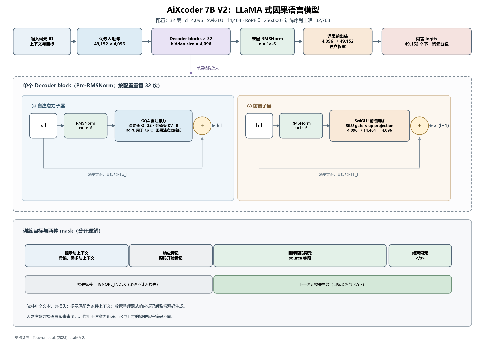

**图 1  AiXcoder 7B V2 的解码器架构及文件级监督。** 根据模型配置与预归一化因果 Transformer 结构绘制，解码块的组件组织参考 LLaMA 2。[[14]](https://arxiv.org/abs/2307.09288) 图中展示单个解码块及其堆叠方式；目标源码位置参与监督，提示位置提供生成条件。

设生成输入为 \(x\)，目标源码的词元序列为 \(y=(y_1,\ldots,y_T)\)。自回归模型将条件概率分解为各位置条件概率的乘积：

$$
p_\theta(y\mid x)=\prod_{t=1}^{T}p_\theta(y_t\mid x,y_{<t}).
$$

其中，\(\theta\) 为模型参数，\(y_{<t}\) 表示已经生成的源码前缀。分词器将自然语言、Java 标识符、运算符及格式字符转换为词元，嵌入矩阵再将词元编号映射为向量。模型由此在统一序列中表示行为描述与程序结构，并预测后续源码的条件分布。

模型采用旋转位置编码（rotary position embedding，RoPE），在注意力查询和键中引入位置信息，使注意力分数能够反映词元之间的相对位置。[[10]](https://arxiv.org/abs/2104.09864) 位置关系与变量定义及使用、括号配对和控制流等程序结构密切相关。输入序列同时标明需求、骨架与目标源码的边界，为各类内容的条件关系提供显式表示。

### 3.3 因果注意力与解码层

Transformer 通过注意力机制建立序列位置之间的关联。[[9]](https://arxiv.org/abs/1706.03762) 对某一层的输入表示 \(H\)，线性投影得到查询、键和值；经过位置变换的查询和键分别记为 \(\widetilde Q\)、\(\widetilde K\)。单个注意力头的计算为：

$$
\operatorname{Attention}(H)=\operatorname{softmax}\left(\frac{\widetilde Q\widetilde K^\top}{\sqrt{d_k}}+M\right)V.
$$

其中，\(d_k\) 为键向量维度。因果掩码 \(M\) 将当前位置之后的注意力分数设为负无穷，使目标词元的预测仅依赖输入条件及此前的源码。多头注意力采用不同投影建立位置间的表示关联，再将各头输出拼接并映射回隐藏空间。模型采用分组查询注意力（grouped-query attention，GQA），由多个查询头共享键和值，从而减少键值状态的存储开销。[[11]](https://arxiv.org/abs/2305.13245)

在本文模型配置中，4,096 维隐藏状态投影为 32 个查询头，每头维度为 128；键和值分别具有 8 个头，因此每 4 个查询头共享一组键和值。各查询头仍根据自身查询计算注意力权重，共享键值并不意味着各头具有相同的注意力分布。32 个头的输出拼接后恢复为 4,096 维，再经输出投影进入残差分支。这一结构在保持多组查询表示的同时，减少了长序列训练与生成中需要维护的键值表示。

解码层还包含归一化、残差连接和逐位置前馈网络。前馈网络采用门控非线性变换，其形式为：

$$
\operatorname{FFN}(h)=W_{\mathrm{down}}\left[\operatorname{SiLU}(W_{\mathrm{gate}}h)\odot(W_{\mathrm{up}}h)\right].
$$

其中，\(W_{\mathrm{gate}}\)、\(W_{\mathrm{up}}\) 和 \(W_{\mathrm{down}}\) 分别为门控、特征扩展和回投影矩阵，\(\odot\) 表示逐元素乘法。SiLU 激活满足 \(\operatorname{SiLU}(z)=z/(1+e^{-z})\)，用于调节另一条投影分支的特征。该前馈网络先将特征扩展至 14,464 维，再映射回隐藏维度，对各词元位置独立进行非线性变换。

解码块采用预归一化结构：在注意力与前馈子层之前，均方根归一化（root mean square normalization，RMSNorm）按特征维的均方根调整表示尺度；子层输出与输入通过残差连接相加。注意力负责聚合其他位置的信息，前馈网络负责变换各位置的组合特征。最后一层表示经词表投影与 softmax 得到下一词元分布。该结构统一建模自然语言与源码，具体生成结果仍取决于输入上下文的充分性及训练中形成的条件关联。

### 3.4 目标源码的监督学习目标

本文的监督训练序列由提示 \(x_i\)、完整目标源码 \(y_i\) 和结束标记拼接而成。训练采用教师强制，在预测各源码词元时使用真实的前序源码作为条件。提示及填充位置的标签被屏蔽，交叉熵仅在目标源码与有效结束位置计算。设 \(z_i\) 为拼接序列，\(m_{it}\) 为目标位置掩码，则单条序列的有效词元平均损失为：

$$
\ell_i(\theta)=-\frac{\sum_t m_{it}\log p_\theta(z_{it}\mid z_{i,<t})}{\sum_t m_{it}}.
$$

目标源码与有效结束位置取 \(m_{it}=1\)，提示和填充位置取零。各设备根据本批样本计算梯度，再通过分布式训练汇总更新。该目标衡量目标词元的条件概率，与文件级功能通过率具有不同统计含义。大量常见词元的预测概率提高可以降低平均损失，而少数关键 API、类型声明或边界分支的错误仍可能导致文件评测失败。

本文采用全参数监督微调，更新嵌入、注意力及前馈层等模型权重。为容纳完整模型的参数、梯度和优化器状态，训练采用 DeepSpeed ZeRO-3 进行状态分片。[[12]](https://arxiv.org/abs/1910.02054) bfloat16（BF16）低精度计算、梯度检查点与高效注意力分别通过数值精度、激活重计算和计算实现优化降低资源需求，支持上述源码条件生成目标的长序列训练。

## 4 数据与监督样本构造

### 4.1 领域数据与总体流程

按最终功能实验范围统计，筛选后纳入本文分析的 Java 样本共 1,204 条，其中训练记录 984 条、共享评估样本 220 条。本实验采用共享评估数据，未另设独立测试集，功能通过率均按这 220 条固定样本计算。三个领域采用一致的文件生成接口和监督目标，结果再按领域与仓库分组。图 2 展示样本构造流程，图 3 和表 4 给出最终纳入分析的数据规模。

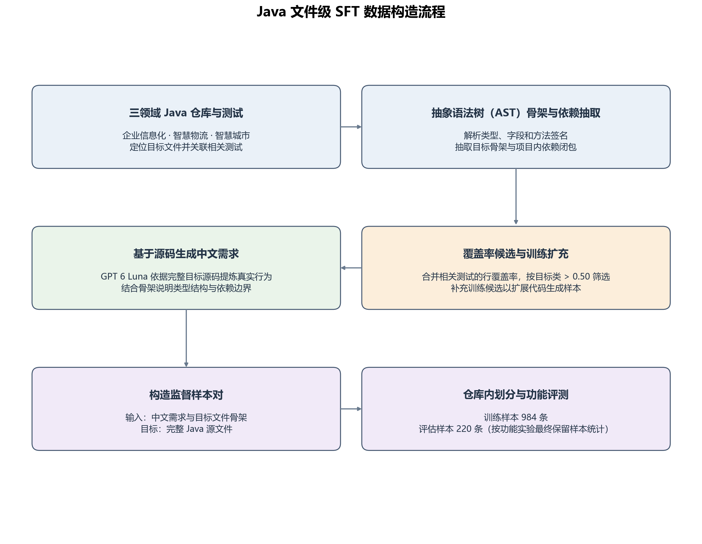

**图 2  源码驱动的领域文件样本构造流程。** 仓库解析、结构骨架和测试覆盖信息用于形成候选；GPT 6 Luna 基于目标源码与结构上下文构造自然语言需求，之后与骨架和完整源码组成文件级监督样本。训练扩充样本不进入功能评测抽样。

**表 4  Java 文件样本的领域划分**

| 领域 | 有效样本总数 | 训练记录 | 共享评估样本 |
|---|---:|---:|---:|
| 企业信息化 | 412 | 336 | 76 |
| 智慧物流 | 510 | 408 | 102 |
| 智慧城市 | 282 | 240 | 42 |
| 合计 | 1,204 | 984 | 220 |

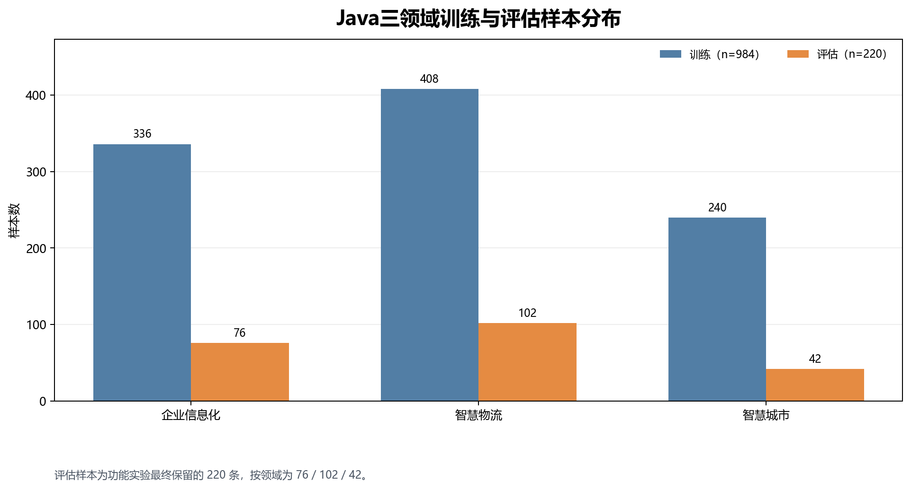

**图 3  Java 三领域最终纳入分析的训练与共享评估规模。** 训练记录共 984 条，共享评估样本共 220 条，合计 1,204 条有效样本。

### 4.2 仓库、文件与骨架候选

企业信息化样本涉及事件驱动、HTTP 客户端、分布式协调及企业应用；智慧物流样本主要来自 OpenTCS 的运输与设备控制代码；智慧城市样本覆盖地图打印、地理接口、地形计算和物联网设备管理。最终 220 个评测文件来自 9 个仓库，逐仓库规模和 GitHub Star 数快照见附录 C.1。Star 数用于描述社区流行度；候选是否可用于功能评测由关联测试和覆盖率规则决定。

候选构造使用 Java 开发工具包（Java Development Kit，JDK）的语法树接口解析主源码和测试源码。语法树将类型、成员和调用表达式表示为结构化节点，用于建立类型、方法与测试调用关系。目标文件位于 Java 主源码目录，排除测试目录，大小不超过 10,000 字节。文件级候选以完整源文件为目标，与函数级补全样本分别构造；当同一文件路径对应多个候选类时，保留覆盖率较高的候选。

骨架抽取保留包声明、导入、类型结构、成员和方法签名，移除字段初始化值与方法体。依赖骨架闭包是从目标文件出发，沿源码中的导入和类型引用递归收集本仓库中可解析到的 Java 文件骨架。重复文件只保留一次，目标骨架置于首位，递归在没有新文件可加入时终止；无法在本仓库骨架索引中解析的外部库类型不进入该集合。样本保存目标骨架及其依赖闭包，供需求构造使用；第 5.1 节进一步说明源码生成提示实际采用的骨架范围。

### 4.3 关联测试与行覆盖率筛选

对候选类源码范围内的可执行行集合 \(E\)，将直接相关且成功运行的测试所覆盖行合并为 \(C\)，并要求：

$$
\operatorname{Coverage}=\frac{|C\cap E|}{|E|}>0.50.
$$

合并按源码行号去重，且至少存在一个具有正向覆盖的成功测试。该比例针对目标文件中的候选类，不是整仓库覆盖率；若文件还包含其他类型，不能据此推定这些类型具有相同覆盖率。当前评测记录的覆盖率最小值为 50.77%，中位数为 87.88%，最大值为 100%。

筛选使用 Java 代码覆盖率工具 JaCoCo 的可用结果，以测试执行约束候选的实际行为。覆盖率筛选增加了目标实现具有可观测执行行为的机会，但被执行的源码行并不等同于被断言充分检查的行为。为扩充源码监督，另加入同仓库中具有骨架、但未达到功能评测候选条件的业务文件，保留在训练部分。相对于可测试候选，这类样本的扩充上限在企业信息化和智慧物流领域为 1 倍，在智慧城市领域为 4 倍；它们不进入共享评估集合。

### 4.4 基于大模型的行为需求生成

自然语言需求由 GPT 6 Luna 根据目标文件的真实参考源码生成。输入包含仓库用途、目标路径、目标骨架、同仓库依赖骨架和完整参考源码。其中，完整源码提供行为事实，骨架用于确认类型结构、可见签名和依赖边界。生成的中文行为需求与对应目标文件绑定，作为监督输入的一部分；该步骤将既有实现转写为可核对的需求文本，而不生成替代代码实现。

需求生成提示规定七个覆盖方面：文件职责、依赖、模块行为、符号行为、API 调用、异常与边界、集成约束。提示要求分别描述构造器、重载方法和嵌套类型，并依据源码说明参数、返回值、状态变化及外部副作用。对外部 API，重点说明调用目的、输入及返回结果的后续用途，不扩展到源码未给出的依赖内部行为。附录 B 提供提示词展示版及真实样本节选。

对坐标类，需求需明确坐标类型、相等性判定、哈希值和字符串表示；对业务类，则需说明处理顺序、条件分支及状态变化。因需求由目标源码反向提炼，其信息粒度与实际用户最初提供的业务描述可能不同，实验结果应解释为在这些细化约束下的文件实现表现。

### 4.5 文件划分与共享评估范围

文件留出在每个仓库内分别进行，以种子 42 和仓库名初始化随机过程。训练扩充记录保留在训练侧，可测试候选经抽样和筛选形成共享评估集合。数据划分以文件为单位，同一目标文件的需求、骨架和参考源码保持对应关系。

984 条训练记录由 703 条训练扩充记录及 281 条可测试候选中的保留记录组成。共享功能评估集合经候选抽样与筛选后确定，包含企业信息化 76 条、智慧物流 102 条及智慧城市 42 条。目标文件是划分与评测的共同单位，训练记录和这 220 个评估文件的目标标识及完整源码无交叉重复，但共享仓库背景。

共享评估结果用于比较模型在这组固定文件上的实现行为。评估数据未与验证用途进一步隔离，因此所报功能通过率不作为独立测试集上的泛化估计。

### 4.6 文件规模与上下文长度分布

本节按表 4 的有效样本范围，比较 984 条训练记录与 220 条共享评估样本，分别按领域计算目标源码行数、提示字符数及目标骨架字符数。源码行数按换行符分段计量，保留空白、注释和末尾空段，描述文件的文本规模。提示和骨架长度取实际保存的对应字符串，在分词与训练截断之前计算；提示包含结构信息和行为需求，骨架长度仅对应目标文件结构。上述统计不等同于模型词元数。表 5 列出各组中位数，图 4 展示分布范围。

**表 5  Java 文件级监督样本的长度中位数**

| 领域 | 划分 | 样本数 | 源码行数中位数 | 提示字符数中位数 | 目标骨架字符数中位数 |
|---|---|---:|---:|---:|---:|
| 企业信息化 | 训练 | 336 | 78.5 | 8,000 | 707.5 |
| 企业信息化 | 共享评估 | 76 | 122 | 9,967.5 | 994.5 |
| 智慧物流 | 训练 | 408 | 71 | 7,960.5 | 758 |
| 智慧物流 | 共享评估 | 102 | 78 | 9,246 | 1,007 |
| 智慧城市 | 训练 | 240 | 75 | 9,104 | 898.5 |
| 智慧城市 | 共享评估 | 42 | 112.5 | 10,897 | 1,116 |

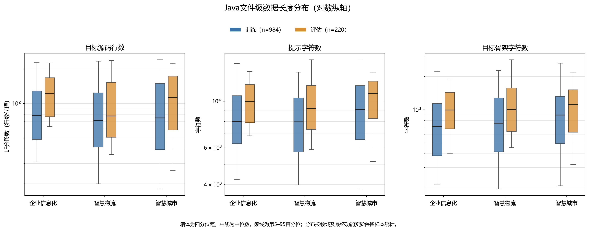

**图 4  Java 三领域监督数据的文件与上下文长度分布。** 箱体为第 25 至第 75 百分位数，中线为中位数，须线为第 5 至第 95 百分位数；纵轴采用对数刻度，须线之外的观测未绘出。蓝色为训练记录，橙色为共享评估样本。

三个领域的共享评估样本在三项长度指标上的中位数均高于相应训练记录，但不同指标反映的领域差异并不完全相同。智慧城市的提示和骨架字符数中位数在两种划分中均最高，企业信息化评估文件的源码行数中位数则更高。输入条件规模、目标源码规模与声明结构规模因而需要分别描述，不能由其中一项代替其他两项。

训练与共享评估样本的长度差异还与来源构成有关。984 条训练记录中，703 条为训练扩充样本，占 71.4%，其余 281 条满足功能评测候选条件，但在文件划分中保留于训练侧。企业信息化和智慧物流的训练记录分别包含 208 条、255 条扩充记录，智慧城市的 240 条训练记录则全部来自扩充部分。共享评估样本不含扩充记录。因此，长度分布需要结合样本来源和选择条件解释，不能仅归因于随机抽样波动。

文件长度描述的是规模，业务复杂度还取决于行为关系。较长文件可能包含较多常量、访问器或重复配置，较短文件也可能集中处理状态转换、协议边界或几何关系。目标骨架提供类型与成员约束，需求说明这些成员如何协作，参考源码提供具体实现；这三类信息的作用无法由单一行数或字符数概括。第 7 节进一步按相同口径的源码行数分析功能结果，并结合真实业务案例解释跨方法约束。

## 5 领域监督微调

### 5.1 输入序列与文件结构条件

训练提示采用代码补全模型的文件任务格式，在结构区域放置目标文件骨架，随后给出任务标记、目标路径、语言和细化行为需求。Java 需求逐行以注释形式写入，完整参考源码作为响应保留。序列的核心组织形式如下：

```text
[目标文件骨架及结构区域标记]
[文件级任务标记、目标路径与语言]
// [逐行写入的细化行为需求]
The complete source code begins below:
[完整目标文件源码]
</s>
```

方括号表示对应记录中的实际文本片段。英文起始标记界定源码响应的开始，`</s>` 表示序列结束。训练时将提示、完整源码和结束标记顺序拼接，目标源码中的声明、方法实现及原有注释共同构成监督内容。推理输入包含条件提示和源码起始标记，由模型生成其后的完整文件。

每条源码生成提示只使用去重骨架列表的首项，即目标骨架。完整依赖骨架闭包用于需求构造，未整体展开到该提示中。因此，目标结构以签名形式直接提供，部分跨文件行为关系则通过需求描述和模型已有表示参与生成。需求构造与源码生成两个阶段的信息范围由表 3 区分。

### 5.2 响应标签与位置对齐

数据整理器将词元序列复制为对齐标签，再定位源码响应标记。提示和标记本身的标签被设置为忽略值，计算损失时跳过这些位置；标记后的源码和有效结束位置保留为预测目标。标签屏蔽不阻止模型读取提示：提示仍通过注意力为后续源码提供条件。因果注意力掩码限制可访问的信息位置，响应标签掩码限定参与损失的位置，两者作用不同。

因果语言模型在计算损失时，将一个位置的预测分布与下一位置的目标标签配对，按第 3.4 节的目标计算有效源码词元平均交叉熵。当前单卡批大小为 1，各设备先得到单个样本的有效响应平均损失，再汇总多卡梯度进行更新。该计算不以八张卡上的目标词元总数重新加权，因此长文件不会仅因包含更多词元而按比例获得更大的样本权重。

源码词元损失与工程通过率关注不同单位。一个关键类型转换或接口调用的错误可能只涉及很少词元，却足以阻止整个文件通过；相反，文本不同的实现也可能满足同一行为。本文以词元损失观察优化过程，以文件级测试结果评价生成后的工程行为。

### 5.3 序列长度与样本边界

基础模型的位置配置上限为 65,536 个词元，训练序列上限设为 32,768 个词元。训练使用 Hugging Face 的后训练库 TRL（Transformer Reinforcement Learning），在提示、源码和结束标记组成的序列上进行分词与长度截断。超过上限的部分不进入监督计算，提示与源码共同占用该长度预算。因此，最大序列长度描述处理上限，不表示每条样本的全部内容均被保留。

样本按文件分别组织，每条序列对应一个目标文件，未将多个短文件打包为新的固定长度训练块。数据整理采用无填充模式，移除批次中的填充位置并提供相应的位置编号。由于单卡每批仅处理一条记录，且分词阶段不增加填充，多样本长度差不会在该设备的小批次中形成额外填充。样本长度分布见第 4.6 节，其中的字符数和源码行数用于描述原始文本规模，与本节分词后的长度上限具有不同单位。

### 5.4 全参数更新与分布式计算

监督微调以 AiXcoder 7B V2 初始化，更新全部模型参数。Hugging Face Accelerate 负责启动训练进程与协调设备，分布式训练引擎 DeepSpeed 负责模型状态组织。单机使用 8 个 GPU 训练进程，单卡批大小为 1、梯度累积步数为 1，每次优化步涉及 8 条记录。Java 部分的数据规模见表 4，完整运行的数据构成与超参数列于附录 A.1。

优化器为 AdamW，即使用解耦权重衰减的自适应矩估计方法。峰值学习率为 \(5\times10^{-6}\)，前 5% 优化步用于学习率预热，随后线性衰减；权重衰减系数为 0.01，梯度范数裁剪阈值为 1.0。DeepSpeed ZeRO-3 将参数、梯度和优化器状态分片存储在不同设备上，并在计算需要时协调相应状态，从而降低每个设备长期保存完整训练状态的需求。[[12]](https://arxiv.org/abs/1910.02054)

BF16 采用 16 位浮点格式降低权重与激活的存储需求；梯度检查点减少保存的中间激活，在反向传播时重计算相应前向结果。FlashAttention-2 优化注意力计算中的显存访问。[[13]](https://arxiv.org/abs/2307.08691) Liger 提供融合训练算子，减少部分独立算子的中间存储与调度。[[16]](https://github.com/linkedin/Liger-Kernel) 这些计算机制支持长序列全参数训练，不改变源码响应的监督目标。

训练过程记录覆盖 10 轮、2,280 个优化步，运行耗时约 4.02 小时。图 5 展示全部训练步的损失、50 步移动平均、逐轮验证损失及学习率。训练损失保留逐步观测，验证损失保持每轮评估的实际记录频率，第 8.2 节进一步讨论二者的关系。训练曲线与功能评测预测来自不同的历史记录，无法将功能结果对应到曲线中的某个检查点，因此两者分别用于分析优化过程与文件生成表现。

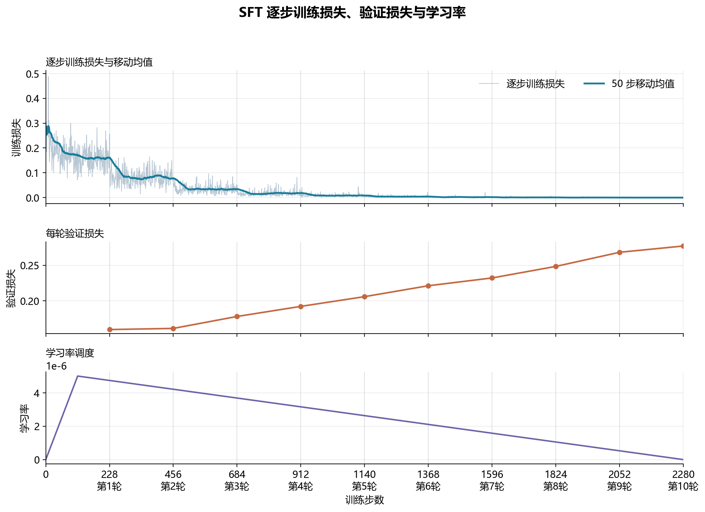

**图 5  领域 SFT 的细粒度训练轨迹。** 训练损失保留逐步观测并叠加 50 步移动平均；验证以每轮记录为准，不对缺少的逐步验证值作插值。学习率与损失使用各自标注的坐标轴。

### 5.5 梯度幅度与优化过程

梯度范数用于概括更新时梯度向量的整体幅度。该次训练的逐步记录显示，前 114 个预热步的范数中位数为 4.224，之后为 0.902，最后 228 步为 0.0149；第 546 步出现 99.17 的局部峰值。图 6 展示原始记录及滚动中位数，保留短期波动与整体下降趋势。

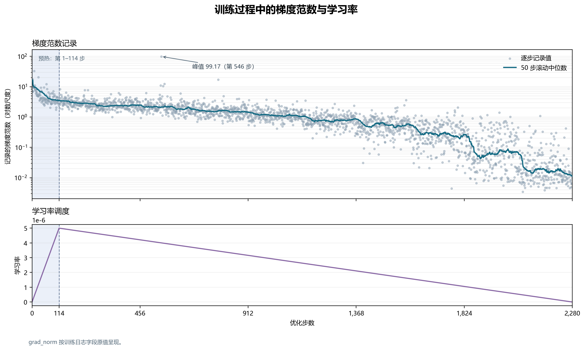

**图 6  训练过程的梯度范数与学习率。** 上图为日志记录值与 50 步滚动中位数，纵轴采用对数尺度；下图为学习率调度。范数按记录值呈现，不据其与裁剪阈值的大小关系推断裁剪发生次数。

范数与训练损失的整体下降共同描述了参数优化信号的变化，但其中同时包含预热、学习率衰减、参数拟合及样本次序的影响。一次峰值也不足以单独判定优化发散。此类轨迹用于解释训练过程，仍需结合验证损失和文件生成结果评价最终任务表现。

## 6 功能评测设置

### 6.1 配对对象与生成条件

功能比较覆盖相同的 220 个 Java 文件，比较 AiXcoder 7B V2 基础预测与领域监督微调后的离线预测。两组预测使用相同目标路径、参考源码、需求和测试定义，每个文件仅生成一条预测，不进行多候选择优，也不依据测试反馈迭代修改。基础生成采用补全式输入和目标骨架，温度为 0、top-p 为 0.95、最大输出为 8,192 个词元。离线 SFT 预测采用可变输出预算，中位数为 2,076 个词元，范围为 1,024–11,286 个词元。

该比较反映两组已保存预测在固定目标上的功能差异，涵盖模型适配、输入组织和生成配置的整体影响。本文按相同文件与关联测试报告功能结果，训练损失用于观察优化过程，功能差异不作特定训练轮次的等预算消融解释。

### 6.2 文件提取、回填与测试

模型输出首先经过源码提取：移除包裹文本和结束标记，定位 Java 源码声明，并保留至最后一个闭合大括号。若输出缺少进入工程构建所需的基本文件结构，则记为提取错误。通过提取仅表示结果具备后续工程检查条件，语法正确性和行为正确性仍由构建与测试决定。

评测过程将完整预测写入工程目标路径，并按工作目录和测试命令组合去重，再运行相关测试命令。每个样本结束后恢复目标文件，避免不同预测之间的修改累积。生成文件需满足原工程的包名、类型和接口约束；与参考文本不完全相同并不影响判定，只要相关测试命令均成功即可通过。

### 6.3 指标与错误分析单位

主要指标为文件级通过率：

$$
\operatorname{PassRate}=\frac{1}{N}\sum_{i=1}^{N} I_i.
$$

当第 \(i\) 个文件能够完成源码提取并写入目标路径，且所有去重后的关联测试命令均未超时、退出码均为 0 时，\(I_i=1\)，否则为 0。当前 220 个样本均关联测试，提取错误、构建失败、测试失败及运行错误均留在分母中。测试命令可能对应单个方法、一个测试类或多个用例，因此命令数量不等同于 JUnit 用例数或断言数。

错误分析以文件为单位，每个未通过样本仅计入一个主要失败类别。类别依据编译诊断、断言和运行错误确定，并优先标记与生成文件直接相关的终止原因；相同日志及多个命令引起的重复失败不重复计数。无法可靠区分多个原因时归入其他类别。该统计描述可观察到的首要失败阶段，不代表穷尽文件中的全部缺陷。

为区分输出完整性与后续工程行为，补充统计候选源码提取成功、可观察到测试任务结果及全部关联命令成功三个阶段。Gradle 和 Maven 是本实验仓库使用的构建工具，Surefire 是 Maven 执行测试的组件。若命令输出包含有效 Gradle 测试任务状态或正数测试执行摘要，则将该文件计为至少一条关联命令到达测试阶段；该条件不要求所有关联命令成功。构建工具返回的缓存结果也属于可观察任务结果，与本次非缓存任务执行记录分别统计。各阶段均以同一组 220 个目标文件为分母，不将同一文件的多条命令累加为多个样本。

仓库聚合采用两种权重。设第 \(j\) 个仓库有 \(N_j\) 个文件，其中 \(P_j\) 个通过，仓库总数为 \(J\)，则文件微平均和仓库宏平均分别为：

$$
R_{\mathrm{micro}}=\frac{\sum_{j=1}^{J}P_j}{\sum_{j=1}^{J}N_j},\qquad
R_{\mathrm{macro}}=\frac{1}{J}\sum_{j=1}^{J}\frac{P_j}{N_j}.
$$

微平均为每个文件赋予相同权重，宏平均为每个仓库赋予相同权重。两种口径复用同一批配对预测，其差异来自聚合权重。

## 7 结果与对比分析

### 7.1 整体与三领域表现

表 6 和图 7 汇总了同一批 220 个 Java 目标文件在 AiXcoder 7B V2 基础预测与领域微调模型离线预测下的配对功能评测结果。基础预测有 42 个文件通过，领域微调预测有 169 个文件通过，整体通过率提高 57.73 个百分点。三个领域的通过率均有提升，增幅介于 56.58～59.52 个百分点。

**表 6  相同 Java 文件与测试条件下的配对功能评测**

| 领域 | 文件数 | 基础通过数 | 基础通过率 | SFT 通过数 | SFT 通过率 | 差值／百分点 |
|---|---:|---:|---:|---:|---:|---:|
| 企业信息化 | 76 | 11 | 14.47% | 54 | 71.05% | +56.58 |
| 智慧物流 | 102 | 25 | 24.51% | 84 | 82.35% | +57.84 |
| 智慧城市 | 42 | 6 | 14.29% | 31 | 73.81% | +59.52 |
| 合计 | 220 | 42 | 19.09% | 169 | 76.82% | +57.73 |

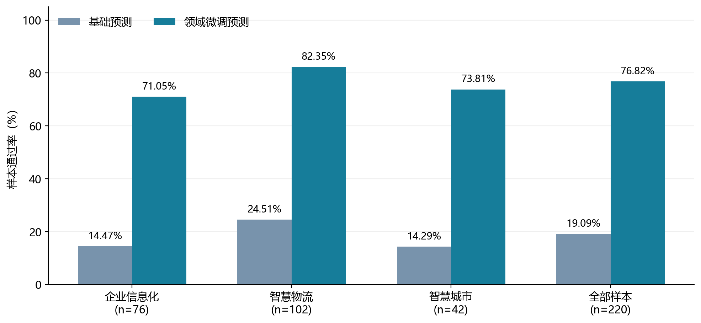

**图 7  三领域及整体的文件级通过率。** 两组均以各领域全部目标文件为分母；智慧城市领域微调预测中的 1 个文件提取错误仍计入 42 个目标文件，不计为通过。

智慧物流在两组预测中的通过率均为三领域最高，但该领域的 102 个样本全部来自 OpenTCS，领域差异与仓库特征因此无法分离。企业信息化样本覆盖四个仓库及不同框架和 API；智慧城市样本则涉及地图、地理接口和物联网等不同类型。领域均值反映当前样本构成的整体结果，不能据此假定各仓库或业务组件具有相同难度，故需结合仓库级结果进行解释。

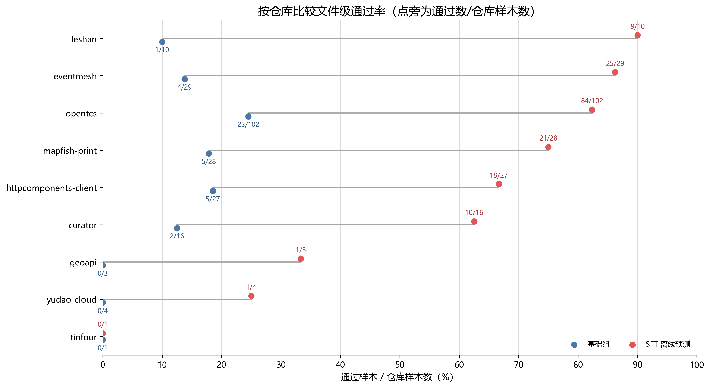

**图 8  各仓库的文件级通过率。** 图中同时标注样本量。对于样本较少的仓库，单个文件的状态变化会显著影响比例，因此应结合分子和分母解读。

多数仓库的通过率有所提高，但提升幅度和最终水平存在差异。Leshan 从 1/10 提高到 9/10，EventMesh 从 4/29 提高到 25/29；样本量较大的 OpenTCS 子集从 25/102 提高到 84/102。yudao-cloud 从 0/4 提高到 1/4，Tinfour 的 1 个目标文件在两组中均未通过。由此可见，领域汇总结果不能代替对具体框架和小样本仓库的分析；其适用性仍需结合接口约束及文件级失败原因判断。

**表 7  文件微平均与仓库宏平均通过率**

| 聚合口径 | 统计范围 | 基础预测 | 领域微调预测 | 差值／百分点 |
|---|---|---:|---:|---:|
| 文件微平均 | 220 个文件等权 | 19.09% | 76.82% | +57.73 |
| 仓库宏平均 | 9 个仓库等权 | 10.80% | 57.90% | +47.10 |

表 7 表明，在降低大样本仓库权重后，两组预测之间仍有较大差异，但宏平均低于相应微平均。OpenTCS 的 102 个文件占总样本的 46.36%，且其通过率较高，因此对文件微平均具有较大影响。仓库等权后，样本较少且通过率较低的仓库获得更高相对权重。宏平均有助于观察结果对仓库构成的敏感性，但单个文件也会显著影响小样本仓库比例，不能将其解释为更精确的总体能力估计。

### 7.2 从源码提取到工程测试

表 8 和图 9 将同一批文件的不同评测阶段并列呈现。基础预测的 220 个输出均可提取出候选源码，但只有 46 个文件的命令日志记录到测试任务结果，42 个文件的全部关联命令成功。领域微调预测有 219 个文件完成提取，183 个具有测试任务结果，169 个全部通过。候选提取比例接近，但后续工程检查的结果存在明显差异。

**表 8  文件级评测的阶段结果（每组均为 220 个文件）**

| 阶段 | 基础预测文件数 | 领域微调预测文件数 |
|---|---:|---:|
| 可提取候选源码 | 220 | 219 |
| 至少一条关联命令有测试任务结果，含缓存 | 46 | 183 |
| 其中至少一条具有非缓存执行记录 | 43 | 143 |
| 全部关联命令退出成功且未超时 | 42 | 169 |

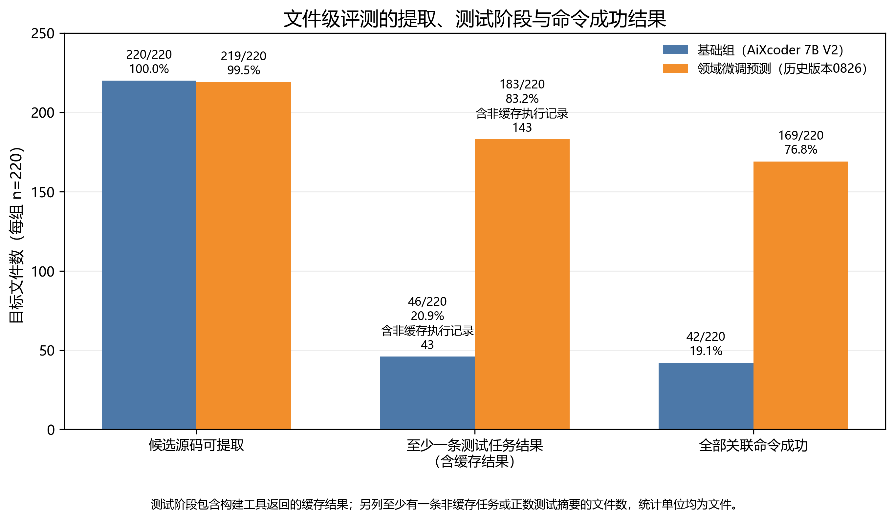

**图 9  从候选源码提取到测试任务结果与全部命令成功。** 每根柱均按文件计数。测试阶段包含构建工具返回的缓存结果；另标含至少一条非缓存测试执行记录的文件数。该阶段指标不表示一个文件的全部测试均已重新执行。

基础组有 174 个文件完成源码提取但未观察到测试阶段结果，领域微调组为 36 个，另有 1 个输出提取错误。按文件配对，141 个文件由未观察到测试阶段结果转为可观察到结果，4 个发生反向变化。这些结果与第 7.4 节中编译类失败减少的现象相符，说明总体改善的重要组成是更多生成文件能够进入工程测试流程。

测试阶段记录仍需区分缓存与非缓存状态。基础组有 3 个文件仅观察到缓存测试任务结果，领域微调组为 40 个。缓存结果参与原构建工具的命令判定，但不等同于重新执行全部相关测试。本文据保存的命令状态报告文件通过率，并将至少一条命令有结果、非缓存执行记录与全部命令成功分别列出，保持三个统计层次的区别。

### 7.3 配对状态迁移与失败修复

配对分析显示，基础预测中未通过的 178 个文件有 131 个在领域微调预测中转为通过，占 73.60%。基础预测中通过的 42 个文件里，38 个继续通过，3 个转为失败，另有 1 个因输出提取错误未能进入测试。以通过文件数计，两组之间的净增量为 \(131-3-1=127\)。图 10 汇总了上述样本级状态迁移。

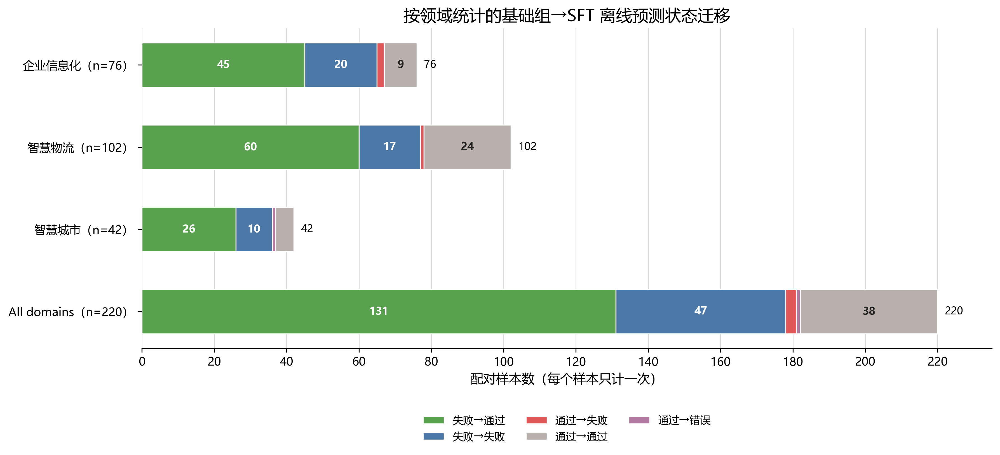

**图 10  配对文件的预测状态迁移。** 图中同时呈现失败转通过、失败状态延续、通过转失败及输出提取错误，便于区分总体提升与个别回退。

### 7.4 首要失败阶段分析

表 9 和图 11 按目标文件统计每组的首要失败类别。基础预测的 178 个未通过文件中，有 174 个首先在编译阶段失败，常见原因是语法或结构错误以及符号无法解析；领域微调预测的编译类失败为 36 个。类型与 API 约束错误从 16 个降至 13 个，变化幅度小于语法或结构错误从 115 个降至 14 个的变化。该分布表明，两组差异主要体现在形成完整且可编译实现的文件数量上，类型与 API 约束仍是较常见的编译问题。

**表 9  文件级首要失败类别计数（每组分母均为 220）**

| 首要失败类别 | 基础预测 | SFT 预测 |
|---|---:|---:|
| 编译：语法或结构 | 115 | 14 |
| 编译：缺失符号 | 40 | 8 |
| 编译：类型与 API 约束 | 16 | 13 |
| 编译：其他明确诊断 | 3 | 1 |
| 测试：断言或预期结果不符 | 3 | 8 |
| 测试：运行异常 | 1 | 6 |
| 完整文件提取错误 | 0 | 1 |
| 非通过合计 | 178 | 51 |

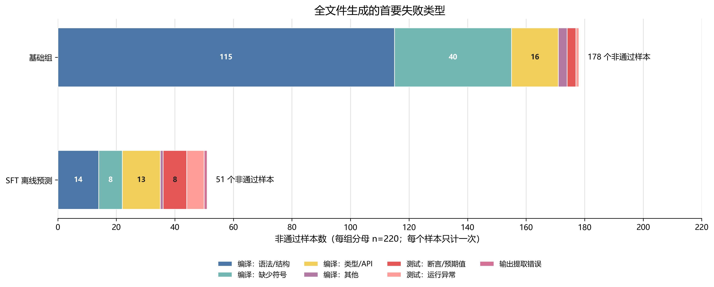

**图 11  两组预测的文件级首要失败类别。** 图中报告绝对数量，每个文件在每组中只计一次；两组均以 220 个目标文件为分母。

在 131 个失败转通过的文件中，87 个原先属于语法或结构失败，25 个属于缺失符号，14 个属于类型或 API 约束，2 个属于其他明确的编译诊断，另有 3 个属于断言或预期结果不符。由此，128 个修复对应原有编译失败，3 个修复对应测试阶段的失败。该构成描述了当前样本中不同失败阶段的状态变化；它与文件级代码合成所需的结构、成员实现和类型一致性要求相对应，但不足以单独确定各项设计的因果贡献。

领域微调预测中的断言失败和运行异常数量有所增加，应结合编译门槛变化进行配对解释。基础预测中以编译错误为首因的 174 个文件里，128 个转为通过；其余 46 个仍未通过，其中 33 个继续因编译错误未通过，13 个已越过编译阶段但在测试中出现断言失败（7 个）或运行异常（6 个）。此外，基础预测原本通过的文件中有 1 个新增断言失败。因此，领域微调预测中记录的 8 个断言失败和 6 个运行异常，不能全部解释为新出现的语义回退。以原先通过样本为对象，配对分析得到的回退仍为 3 个失败和 1 个输出提取错误，见第 7.3 节。

从输入与监督形式看，目标骨架显式规定类型和成员边界，源码目标则展示这些边界内的实现方式；这一任务结构为大量结构类修复提供了可能的机制解释。配对案例还显示，数值转换、时间单位、空值语义和几何方向等组合约束仍会引发行为错误。第 7.6 节依据相同样本的输出对这些情况作具体比较。

### 7.5 文件规模与配对结果

将 220 个参考文件按源码行数排序，在约三分之一和三分之二位置设置边界，并将相同行数的文件归入同组。由此得到不超过 71 行、72–134 行及超过 134 行三个近等量组，样本数分别为 75、72 和 73。划分仅使用参考文件长度，行数口径与第 4.6 节一致。相同长度组内比较两组保存预测，结果见表 10 和图 12。

**表 10  按参考源码行数分组的文件级通过率**

| 源码行数组 | 文件数 | 基础通过数／通过率 | 领域微调通过数／通过率 |
|---|---:|---:|---:|
| 不超过 71 行 | 75 | 23／30.67% | 67／89.33% |
| 72–134 行 | 72 | 15／20.83% | 61／84.72% |
| 超过 134 行，最大 384 行 | 73 | 4／5.48% | 41／56.16% |

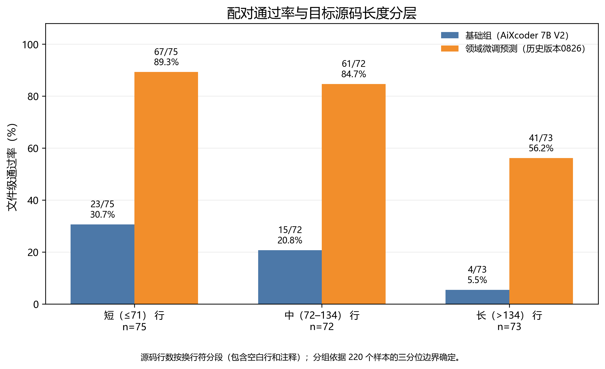

**图 12  按目标源码长度分层的文件级通过率。** 分组边界由全部参考文件的长度确定，柱上标注通过数、分母和比例。源码行数包含空白与注释，属于规模指标。

两组预测在较长文件组的通过率均较低。领域微调预测在短、中两组分别达到 89.33% 和 84.72%，长文件组为 56.16%；三个组相对基础预测均有改善。较长文件通常要求在更大的输出范围中保持声明与行为一致，但这些分层结果只能描述当前样本中的关联，不能把差异全部归因于长度。

仓库构成是重要的共同变化因素。短文件组中有 46/75 个文件来自 OpenTCS，长文件组为 28/73；各仓库使用的依赖、构建规则和测试范围也不同。行数还包含常量、访问器与注释，并不直接度量业务关系的复杂程度。因此，长度分层用于定位需要重点分析的文件范围，具体失败机制仍应结合需求、源码结构和测试结果解释。

### 7.6 配对样本案例分析

本节选取三组配对样本，分别展示类型约束修正、行为语义修正及原通过样本回退。需求以语义摘要呈现，源码保留关键方法或表达式并统一空白；案例用于说明失败机制，不用于估计各类错误的发生频率。空值筛选、可选数值和不完整输出等补充案例见附录 C。

#### 7.6.1 Couple：返回类型约束与编译结果

OpenTCS 的 `Couple` 保存两个不可变的 `long` 字段。输入骨架将字段类型规定为 `long`，并要求 `hashCode()` 返回 `int`；需求同时要求维持相等性与哈希契约。由于两个 `long` 值的异或结果仍为 `long`，返回表达式必须满足方法声明的 `int` 类型约束。

**基础预测：编译失败**

```java
@Override public int hashCode() {
    return x ^ y;
  }
```

**SFT 预测：通过**

```java
public int hashCode() {
    return (int) (x ^ y);
  }
```

基础预测因将 `long` 表达式直接用于 `int` 返回值而触发可能发生有损转换的编译诊断；领域微调预测加入显式 `int` 转换后，同一关联命令执行成功。该样本的差异集中在一个返回表达式，说明即使其余实现结构完整，返回类型不匹配仍足以阻止文件通过编译。

#### 7.6.2 BoundingBoxProtrusionCheck：包围盒越界量的几何语义

OpenTCS 的 `BoundingBoxProtrusionCheck` 比较内、外包围盒，并计算前、后、左、右及顶部的越界量。需求规定，水平方向的越界量由内盒对应边界减去外盒边界得到，仅正差计为越界。以下对照保留后侧分量；完整返回对象还包括其他方向的计算结果。

**基础预测：后侧关键表达式**

```java
Math.max(0,
    outer.getLength() / 2.0 + outer.getReferenceOffset().getX()
        - inner.getLength() / 2.0 + inner.getReferenceOffset().getX())
```

**SFT 预测：后侧关键表达式**

```java
Math.max(0,
    inner.getLength() / 2.0 + inner.getReferenceOffset().getX()
        - (outer.getLength() / 2.0 + outer.getReferenceOffset().getX()))
```

基础预测在后侧表达式中颠倒了边界比较关系，并错误组合参考偏移；领域微调预测按照内盒边界减外盒边界构造该表达式。基础预测关联的 11 条测试命令中有 10 条未成功，日志涉及多个方向及贴边情形的断言差异；领域微调预测关联的 11 条命令均成功。该对照表明，实现是否符合需求取决于方向、参考偏移和差值定义的共同落实，而非仅取决于表达式的语法完整性。

#### 7.6.3 DistributedBarrier：时间单位转换与测试回退

Curator 的屏障等待接口接收 `maxWait` 和 `TimeUnit unit`。对于有限等待，需先将 `maxWait` 从 `unit` 指定的单位转换为毫秒，再与已等待的毫秒数比较。两组预测的关键调用如下。

**基础预测：通过**

```java
TimeUnit.MILLISECONDS.convert(maxWait, unit)
```

**SFT 预测：断言失败**

```java
unit.convert(maxWait, TimeUnit.MILLISECONDS)
```

两个表达式调用同一转换 API，但转换方向相反。领域微调预测将转换结果继续作为毫秒使用，因而改变了有限等待时长，未满足屏障等待测试的预期。基础预测关联的 4 条命令均成功，领域微调预测有 2 条失败。该文件由通过转为未通过，表明格式或编译层面的改进不能替代对时间单位及边界行为的检验。

三组案例分别涉及结构条件、数值关系和行为约束，显示目标骨架与行为需求在文件生成中的不同作用。按输出文本核对，在统一换行并去除首尾空白后，领域微调预测中有 8 个通过文件与参考全文一致，另有 161 个通过文件的全文存在差异。因此，主要指标衡量的是给定工程约束下的测试通过情况，不要求模型逐字符复现参考实现。

### 7.7 外围设备绑定的跨方法业务约束

OpenTCS 的 `PeripheralAttachmentManager` 管理位置与外围设备通信适配器之间的绑定。该目标文件按本文口径计为 283 行，属于较长文件组。通信适配器是接入外围设备的驱动组件；位置条目池记录各位置当前使用的适配器，控制器池维护对应的控制关联，事件总线向其他组件通知绑定及状态变化。该文件需要协调这些依赖的生命周期，体现多个方法共同承担业务职责的文件级约束。

需求要求类在内核启动期间初始化适配器注册表与位置条目池，为尚未绑定的位置选择可用适配器，并根据配置决定是否自动启用；运行时，调用方可按适配器描述为指定位置重新绑定适配器；关闭期间则先禁用并终止已附加适配器，再终止条目池和注册表。成功绑定还需更新条目状态并发布绑定信息和进程模型事件。

评测输入骨架给出生命周期接口 `Lifecycle`、依赖字段和方法签名，具体状态转换由模型实现。以下为输入骨架中的结构节选：

```java
public class PeripheralAttachmentManager implements Lifecycle {
  private static final Logger LOG;
  private final KernelApplicationConfiguration configuration;
  private final InternalPeripheralService peripheralService;
  private final LocalPeripheralControllerPool controllerPool;
  private final PeripheralCommAdapterRegistry commAdapterRegistry;
  private final PeripheralEntryPool peripheralEntryPool;
  private final EventHandler eventHandler;
  private boolean initialized;
  @Override public void initialize();
  @Override public void terminate();
  private void attachAdapterToLocation(PeripheralEntry entry, PeripheralCommAdapterFactory factory);
}
```

基础组生成结果保留了类字段和方法声明，却将 `initialize`、`terminate`、手动绑定及自动绑定等方法留作无方法体的声明。四条关联命令均在编译阶段失败，尚未到达测试阶段。该输出尚未实现需求所要求的状态转换和依赖协作。

评测中的领域微调组预测结果补全了多阶段生命周期控制。初始化方法在已经完成初始化时直接返回，避免重复执行；否则先初始化注册表和条目池，再遍历条目自动绑定，按配置启用适配器，最后设置初始化状态。以下控制流程节选省略了日志输出分支，保留相关语句的顺序：

```java
public void initialize() {
  if (isInitialized()) {
    return;
  }

  commAdapterRegistry.initialize();
  peripheralEntryPool.initialize();

  autoAttachAllAdapters();

  if (configuration.autoEnablePeripheralDriversOnStartup()) {
    autoEnableAllAdapters();
  }

  initialized = true;
}
```

自动绑定仅处理使用 `NullPeripheralCommAdapter` 的条目，该类型是尚未绑定真实驱动时的占位实现。方法查询位置的可用适配器工厂并选择首项；已有真实适配器或没有可用工厂时，保持当前绑定。手动绑定则先读取位置并请求工厂创建适配器，空结果会终止该次替换。成功创建后，生成结果先禁用并终止旧适配器、从控制器池分离旧关联，再初始化并附加新适配器，更新条目状态，最后依次发布绑定事件和进程模型事件。终止逻辑遍历当前条目禁用并终止适配器，之后终止条目池和注册表，并清除初始化标志。这些行为将接口骨架扩展为涵盖初始化、自动选择、手动替换、事件传播和资源清理的生命周期流程。

下面的连续源码节选来自该预测结果，展示创建新适配器且返回非空结果之后的替换顺序，以及两个事件的发布：

```java
    disableAndTerminateAdapter(entry);
    controllerPool.detachPeripheralController(entry.getLocation());

    commAdapter.initialize();
    controllerPool.attachPeripheralController(entry.getLocation(), commAdapter);

    entry.setCommAdapterFactory(factory);
    entry.setCommAdapter(commAdapter);

    eventHandler.onEvent(new PeripheralAttachmentEvent(
        entry.getLocation(),
        new PeripheralAttachmentInformation(
            entry.getLocation(),
            entry.getAvailableCommAdapters(),
            entry.getCommAdapterFactory().getDescription()
        )
    ));
    eventHandler.onEvent(new PeripheralProcessModelEvent(
        entry.getLocation(),
        PeripheralProcessModel.Attribute.LOCATION.name(),
        entry.getProcessModel()
    ));
```

此文件关联了四条带方法选择器的 Gradle 命令，分别对应 `shouldAttachAdapterToLocation`、`shouldAutoAttachAdapterToLocation`、`shouldGetAttachmentInformation` 和 `shouldHaveInitializedPeripheralEntryPool`。基础组四条命令均在编译阶段失败；领域微调预测组四条命令均以退出码 0 结束，日志中的 `:opentcs-kernel:test` 任务均无缓存标记。在这些关联测试限定的范围内，生成实现完成了从结构声明到可执行文件的转换。源码对照进一步表明，成功实现需要使状态标志、适配器生命周期、控制器关联和事件发布保持一致；局部方法的实现还必须满足其他方法所依赖的状态关系。

## 8 讨论

### 8.1 输入组织与观测结果

文件级输入由目标骨架和行为需求共同构成。骨架规定返回类型、成员和方法签名等结构边界，需求描述这些成员应满足的行为条件，参考源码提供相应的实现示范。`Couple` 案例呈现了类型约束与编译结果之间的关系；筛选工厂和屏障等待案例显示，空值与时间单位同样影响测试结果。外围设备绑定管理案例进一步涉及初始化、替换、通知与清理之间的状态关系。上述观察说明，文件级实现既需要局部表达式正确，也需要多个成员共同满足业务流程约束。

两组评测使用相同目标文件和关联测试，比较对象是两套实际预测流程在工程约束下的整体表现。由于提示组织、生成预算和模型适配同时参与该流程，当前比较无法单独量化各因素的贡献。完整依赖闭包未全部进入源码生成提示，也使模型对部分跨文件关系的处理依赖需求描述及既有参数知识。结合首要失败类别与配对样本状态，可以分析这些条件下的典型改善及剩余错误。

### 8.2 训练拟合、验证损失与检查点选择

图 5 所示的训练过程中，训练损失持续下降，而验证损失在第 1 轮后逐步上升，呈现训练拟合增强与验证损失升高的分化趋势。已记录的最低验证交叉熵出现在第 1 轮；继续训练主要改善了对训练数据的拟合。逐轮数值见附录 A.2。

交叉熵与文件级通过率对预测错误的敏感方式不同。常见声明或重复模式的词元概率改善可以降低平均交叉熵，而单个 API 调用、单位换算或边界条件错误就可能导致整个文件未通过；另一方面，语义符合要求但文本不同的实现仍可能通过关联测试。因此，模型选择应同时考察评估指标与功能行为，不能以单一损失值替代工程评价。

### 8.3 领域适用性与评价边界

本实验研究的是在目标骨架和细化行为需求给定条件下，面向既有 Java 仓库的文件级代码合成。需求依据参考源码反向构造，其信息完整度高于未经细化的用户初始需求。训练记录与共享评估样本按文件隔离，但共享仓库背景；因此，结果主要反映模型在既有仓库环境中的适配情况。关联测试及候选类行覆盖率超过 50% 的筛选条件为行为评测提供了约束，但不能保证覆盖全部业务分支和异常组合。

训练扩充与可测试候选还承担不同作用：前者增加可用于训练阶段的文件，后者经筛选形成共享功能评估对象。训练记录与共享评估样本的来源及长度构成不同，测试结果需要结合样本选择方式解释。长度分层与仓库宏平均进一步显示，整体通过率受到文件规模和仓库权重的共同影响。两组预测在各长度组和仓库等权汇总中均有改善，但其幅度不能直接外推为新仓库或更大文件上的性能。

全参数监督微调能够在全部模型权重上学习任务适配，同时需要存储并同步相应的参数、梯度和优化器状态。状态分片、低精度计算及激活重计算共同支持了本次单机多卡长序列训练，其资源开销仍取决于模型规模、序列长度与全局批大小。仓库构成、需求信息完整度、可见上下文和生成预算共同限定了本实验结论的适用范围。

## 9 结论

本文针对面向特定领域的 Java 文件级代码合成，构建了由细化行为需求、目标骨架和完整源码组成的监督任务，并以 AiXcoder 7B V2 为基础开展全参数领域微调。样本构造结合真实工程源码、GPT 6 Luna 生成需求和关联测试，使训练目标与工程行为评价形成衔接。在三个领域共 220 个文件的配对功能评测中，领域微调预测通过率为 76.82%，基础预测为 19.09%；131 个原失败文件转为通过。九个仓库等权的宏平均通过率也从 10.80% 提高到 57.90%。

阶段结果与错误分布表明，主要改善集中于实现完整性和工程约束，更多文件能够到达测试阶段；源码较长的文件仍有较低通过率。局部错误与完整业务案例共同说明，结构正确性、接口使用和跨方法状态关系需要分层检验。领域源码监督、显式结构条件和可执行测试为文件合成提供了互补约束，其有效性应结合具体仓库、需求信息与测试覆盖范围判断。

## 参考文献

[1] Gururangan S., Marasović A., Swayamdipta S., et al. *Don’t Stop Pretraining: Adapt Language Models to Domains and Tasks*. ACL, 2020, pp. 8342–8360. [论文](https://aclanthology.org/2020.acl-main.740/).

[2] Yu H., Shen B., Ran D., et al. *CoderEval: A Benchmark of Pragmatic Code Generation with Generative Pre-trained Models*. ICSE, 2024. [论文](https://arxiv.org/abs/2302.00288).

[3] Jiang S., et al. *aiXcoder-7B: A Lightweight and Effective Large Language Model for Code Processing*. arXiv:2410.13187. [论文](https://arxiv.org/abs/2410.13187).

[4] Li J., Zhu H., Liu H., et al. *aiXcoder-7B-v2: Training LLMs to Fully Utilize the Long Context in Repository-level Code Completion*. arXiv:2503.15301, 2025. [论文](https://arxiv.org/abs/2503.15301).

[5] Bavarian M., et al. *Efficient Training of Language Models to Fill in the Middle*. arXiv:2207.14255, 2022. [论文](https://arxiv.org/abs/2207.14255).

[6] Zhang F., et al. *RepoCoder: Repository-Level Code Completion Through Iterative Retrieval and Generation*. EMNLP, 2023. [论文](https://aclanthology.org/2023.emnlp-main.151/).

[7] Ding Y., et al. *CrossCodeEval: A Diverse and Multilingual Benchmark for Cross-File Code Completion*. NeurIPS Datasets and Benchmarks, 2023. [论文](https://arxiv.org/abs/2310.11248).

[8] Wei Y., et al. *Magicoder: Empowering Code Generation with OSS-Instruct*. ICML, PMLR 235, 2024. [论文](https://proceedings.mlr.press/v235/wei24h.html).

[9] Vaswani A., et al. *Attention Is All You Need*. NeurIPS, 2017. [论文](https://arxiv.org/abs/1706.03762).

[10] Su J., et al. *RoFormer: Enhanced Transformer with Rotary Position Embedding*. arXiv:2104.09864. [论文](https://arxiv.org/abs/2104.09864).

[11] Ainslie J., et al. *GQA: Training Generalized Multi-Query Transformer Models from Multi-Head Checkpoints*. EMNLP, 2023. [论文](https://arxiv.org/abs/2305.13245).

[12] Rajbhandari S., et al. *ZeRO: Memory Optimizations Toward Training Trillion Parameter Models*. SC, 2020. [论文](https://arxiv.org/abs/1910.02054).

[13] Dao T. *FlashAttention-2: Faster Attention with Better Parallelism and Work Partitioning*. arXiv:2307.08691. [论文](https://arxiv.org/abs/2307.08691).

[14] Touvron H., et al. *Llama 2: Open Foundation and Fine-Tuned Chat Models*. arXiv:2307.09288, 2023. [论文](https://arxiv.org/abs/2307.09288).

[15] Du X., Liu M., Wang K., et al. *Evaluating Large Language Models in Class-Level Code Generation*. ICSE, 2024. [论文](https://mingwei-liu.github.io/assets/pdf/ICSE2024ClassEval-V2.pdf).

[16] LinkedIn. *Liger Kernel: Efficient Triton Kernels for LLM Training*. [项目文档](https://github.com/linkedin/Liger-Kernel).

## 附录 A 训练配置与优化记录

### A.1 完整训练配方

**表 A1  全参数 SFT 的完整配置**

| 项目 | 设置 |
|---|---|
| 初始化模型 | AiXcoder 7B V2 |
| 参数更新 | 全参数监督微调 |
| 并行 | 单机 8 GPU 进程，DeepSpeed ZeRO-3 |
| 训练／验证单卡批大小 | 1／1 |
| 梯度累积 | 1 步 |
| 有效全局批大小 | 8 |
| 训练轮数 | 10 |
| 实际优化步数 | 2,280，每轮 228 步 |
| 最大序列长度 | 32,768 词元 |
| 学习率 | \(5\times10^{-6}\) |
| 优化器 | AdamW（PyTorch 实现） |
| 学习率调度 | 线性调度，先预热再衰减 |
| 预热比例 | 0.05 |
| 权重衰减 | 0.01 |
| 梯度范数裁剪 | 1.0 |
| 数值精度 | BF16，验证亦使用 BF16 |
| 计算与激活优化 | FlashAttention-2、梯度检查点、Liger 内核 |
| 验证频率 | 每轮一次 |
| 损失记录频率 | 每个优化步 |
| 训练总耗时 | 14,463.44 秒，约 4.02 小时 |

模型的位置配置上限为 65,536 词元，实际训练序列截断长度为 32,768 词元。训练采用 GPU 状态分片，不将参数或优化器状态卸载至 CPU；同时关闭生成缓存，并通过梯度检查点重计算部分激活。验证与模型保存均在每轮结束时进行，训练结束后保留该次训练的最终权重，不自动恢复验证损失最低的检查点。

Java 数据的最终分析规模为 984 条训练记录与 220 条共享评估样本，见表 4。历史运行记录的训练期交叉熵与功能通过率使用不同统计单位：前者按该运行的有效源码词元汇总，后者按固定的 220 个 Java 文件汇总。

### A.2 逐轮指标

**表 A2  逐轮训练均值与验证交叉熵**

| 轮次 | 累计优化步 | 该轮训练损失均值 | 验证损失 |
|---:|---:|---:|---:|
| 1 | 228 | 0.174154 | **0.159281** |
| 2 | 456 | 0.081718 | 0.160901 |
| 3 | 684 | 0.034330 | 0.177754 |
| 4 | 912 | 0.017036 | 0.192000 |
| 5 | 1,140 | 0.008565 | 0.205720 |
| 6 | 1,368 | 0.004205 | 0.221113 |
| 7 | 1,596 | 0.001966 | 0.232121 |
| 8 | 1,824 | 0.000891 | 0.248418 |
| 9 | 2,052 | 0.000334 | 0.268335 |
| 10 | 2,280 | 0.000092 | 0.277174 |

训练损失均值为该轮 228 个训练步记录的算术平均，验证损失为该轮结束时完整验证过程的汇总值。两者的统计时点与汇总方式有所不同。正文图 5 展示逐步训练损失与逐轮验证损失，表 A2 列出相应的逐轮指标。

## 附录 B 需求生成提示与样本展示

### B.1 需求生成 Prompt:

以下提示保留实际模板的核心约束与输入字段，合并重复表述以便阅读。该提示用于 GPT 6 Luna 的需求构造阶段；完整源码在该阶段提供给需求生成模型，代码生成模型接收生成后的需求与骨架。

**系统角色**

> 你是资深 Java 软件架构师，为文件级代码生成编写详细中文需求。以完整参考源码确定行为，骨架仅用于确认结构、可见签名和依赖边界。只输出连贯的自然语言，不输出 Java 实现、伪代码或 JSON，不复制整段源码。源码不能确定的依赖内部行为或隐式业务语义不补写。

**任务与覆盖范围**

> 根据仓库背景、目标骨架、项目依赖骨架和完整参考源码，说明目标文件的职责、模块边界以及各类型与成员的实际行为。分别覆盖重载方法与构造器，保留必要的完整签名、类型、泛型、修饰符、注解和异常声明。解释参数约束、返回值、处理顺序、分支、循环、状态变化、外部副作用和异常传播。关键 API 要说明调用目的、输入及返回结果如何继续使用。

**输出结构**

> 按“文件职责、依赖、模块行为、符号行为、API 调用、异常与边界、集成约束”的顺序组织段落。依赖骨架只提供接口边界，不把其内部实现当作已知事实。多个目标类型分别说明，但不扩展到目标范围之外的文件实现。

**输入槽位**

```text
仓库与目标范围：
{{REPOSITORY_CONTEXT}}

目标文件骨架：
<target_skeletons>
{{TARGET_FILE_SKELETONS}}
</target_skeletons>

项目内依赖骨架：
<dependency_skeletons>
{{DEPENDENCY_SKELETONS}}
</dependency_skeletons>

完整参考源码：
<sources>
{{REFERENCE_SOURCES}}
</sources>
```

该提示将任务界定为可指导文件重实现的行为需求，并按类型、成员、处理流程和边界条件组织覆盖范围。完整源码为行为描述提供依据，骨架限定目标结构与依赖边界。自然语言需求仍可能存在篇幅或表达粒度差异，附录 B.2 和 B.3 展示真实样本的需求摘要与对应源码节选。

### B.2 简单样本：指标名称规范化

样本来自智慧城市领域的 MapFish Print `StatsUtils`。以下为真实需求与源码的阅读节选，未展开完整需求文本。

**需求摘要。** 该工具将名称转换为可作为指标名称点号分段使用的字符串：ASCII 字母、数字和下划线保持不变，其他字符替换为下划线；空引用返回固定文本 `"NULL"`。类不可实例化，对外提供静态转换方法。

**骨架节选**

```java
public final class StatsUtils {
    private StatsUtils();
    public static String quotePart(final String name);
}
```

**目标实现节选**

```java
if (name == null) {
    return "NULL";
}
return name.replaceAll("[^A-Za-z0-9_]", "_");
```

该记录将骨架给出的签名与源码中的空值策略、字符替换规则相对应。需求明确了被保留的字符集合和空值返回值，因而约束超出“规范化名称”这一概括性职责。

### B.3 业务样本：运输订单的路线附加

样本来自智慧物流领域的 OpenTCS `DriveOrderRouteAssigner`。该需求涉及运输订单、路线计算和路线选择三个业务对象。

**需求摘要。** 为运输订单的未来驾驶订单计算并附加路线。`Router` 根据车辆、起始位置、运输订单及候选路线数量上限产生路线候选，`RouteSelector` 选择路线序列。存在选中序列时，按索引将路线附加到对应的未来驾驶订单，构造并返回新的驾驶订单列表；未选出路线时保持空 `Optional`。该方法不承担持久化运输订单或改变车辆状态的职责。

**骨架节选**

```java
public class DriveOrderRouteAssigner {
    private final Router router;
    private final DefaultDispatcherConfiguration configuration;
    private final RouteSelector routeSelector;
    public Optional<List<DriveOrder>> tryAssignRoutes(
        TransportOrder order, Vehicle vehicle, Point startPosition);
}
```

**目标实现节选**

```java
return routeSelector.selectSequence(
    router.getRoutes(vehicle, startPosition, order,
                     configuration.maxRoutesToConsider())
).map(routes -> {
    List<DriveOrder> driveOrderList = new ArrayList<>();
    for (int i = 0; i < routes.size(); i++) {
        driveOrderList.add(
            order.getFutureDriveOrders().get(i).withRoute(routes.get(i))
        );
    }
    return driveOrderList;
});
```

该样本的需求将依赖调用与领域对象转换关联起来：路由候选由 `Router` 计算，路线序列由 `RouteSelector` 选取，随后按索引构造带路线的新驾驶订单。没有可用序列时，方法返回空 `Optional`。这组行为说明组件职责和数据流共同限定了文件实现，目标类不负责持久化运输订单或更新车辆状态。

## 附录 C 仓库结果与扩展案例

### C.1 评测仓库构成

**表 C1  Java 功能评测集构成及仓库 Star 数快照**

| 领域 | 仓库 | Star 快照 | 文件样本数 |
|---|---|---:|---:|
| 企业信息化 | [EventMesh](https://github.com/apache/eventmesh) | 1,746 | 29 |
| 企业信息化 | [Apache HttpComponents Client](https://github.com/apache/httpcomponents-client) | 1,534 | 27 |
| 企业信息化 | [Apache Curator](https://github.com/apache/curator) | 3,172 | 16 |
| 企业信息化 | [yudao-cloud](https://github.com/YunaiV/yudao-cloud) | 19,452 | 4 |
| **企业信息化小计** | **4 个仓库** | — | **76** |
| 智慧物流 | [OpenTCS](https://github.com/openTCS/opentcs) | 561 | 102 |
| **智慧物流小计** | **1 个仓库** | — | **102** |
| 智慧城市 | [MapFish Print](https://github.com/mapfish/mapfish-print) | 197 | 28 |
| 智慧城市 | [Eclipse Leshan](https://github.com/eclipse/leshan) | 689 | 10 |
| 智慧城市 | [GeoAPI](https://github.com/opengeospatial/geoapi) | 140 | 3 |
| 智慧城市 | [Tinfour](https://github.com/gwlucastrig/Tinfour) | 190 | 1 |
| **智慧城市小计** | **4 个仓库** | — | **42** |
| **合计** | **9 个仓库** | — | **220** |

### C.2 Filters：空值筛选语义

OpenTCS 的筛选工厂规定：当 `vehicleRef` 为空时，返回接受所有运输订单的谓词；当其非空时，谓词才依据预期车辆进行匹配。基础预测仍将空引用作为相等比较条件，使空参数仅匹配订单字段为空的情形，未保留空值表示“不施加该筛选条件”的语义。

**基础预测：关键工厂方法**

```java
public static Predicate<TransportOrder> transportOrderWithIntendedVehicle(@Nullable TCSObjectReference<Vehicle> vehicleRef) {
    return order -> Objects.equals(order.getIntendedVehicle(), vehicleRef);
  }
```

**SFT 预测：关键工厂方法**

```java
public static Predicate<TransportOrder> transportOrderWithIntendedVehicle(
      @Nullable
      TCSObjectReference<Vehicle> vehicleRef
  ) {
    return vehicleRef == null
        ? order -> true
        : order -> Objects.equals(vehicleRef, order.getIntendedVehicle());
  }
```

基础预测关联的 10 条测试命令中有 7 条未成功，领域微调预测关联的 10 条命令均成功。两组输出在空条件分支上的差异，与“`null` 表示不限制筛选”这一需求相对应，而非将其解释为只接受对应字段为空的订单。目标文件还实现其他筛选工厂，本节仅对照其中一个分支。

### C.3 PJsonObject：缺失值哨兵与可选值语义

MapFish Print 的 `PJsonObject` 封装了 JSON 字段访问。对于可选整数，底层以缺失值哨兵表示未提供的字段，包装方法需将该哨兵转换为 Java `null`，避免将其作为有效数值返回。代码对照展示 `optInt`；`optLong` 和 `optDouble` 分别处理长整数哨兵及 `NaN`。

**基础预测：关键方法**

```java
@Override public final Integer optInt(final String key) {
    return this.obj.optInt(key, Integer.MIN_VALUE);
  }
```

**SFT 预测：关键方法**

```java
public final Integer optInt(final String key) {
    final int val = this.obj.optInt(key, Integer.MIN_VALUE);
    return val == Integer.MIN_VALUE ? null : val;
  }
```

该差异对应“可选值缺失时返回空值”的约定。基础预测关联的 45 条测试命令中有 6 条未成功，领域微调预测关联的 45 条命令均成功。由于命令还覆盖目标文件中的其他行为，整体测试结果不能归结为 `optInt` 单一方法的变化。该样本表明，API 调用形式正确并不足以保证返回值语义符合领域接口。

### C.4 CacheableRequestPolicy：final 局部变量赋值约束

HttpComponents 的请求缓存策略在请求未提供协议版本时使用默认版本。基础预测通过条件表达式对 `final` 局部变量完成一次赋值；领域微调预测则先赋予请求版本，再在空值分支中为同一变量赋值，与 `final` 修饰符的单次赋值约束冲突。

**基础预测：通过**

```java
final ProtocolVersion pv = request.getVersion() != null ? request.getVersion() : HttpVersion.DEFAULT;
```

**SFT 预测：编译失败**

```java
final ProtocolVersion pv = request.getVersion();
        if (pv == null) {
            pv = HttpVersion.DEFAULT;
        }
```

基础预测关联的 3 条测试命令均成功，领域微调预测关联的 3 条命令均因编译错误未成功。该输出在补充空值分支时违反了局部变量的 `final` 约束，说明控制流修改必须与变量修饰符及赋值方式保持一致。该样本属于 3 个基础预测通过、领域微调预测未通过的文件之一。

### C.5 QuotedStringAttribute：重复注释与输出截断

Leshan 的目标类负责解析带引号的属性值，处理外层引号、转义字符及未闭合字符串异常。基础预测通过关联测试。领域微调预测重复输出相同的 Javadoc 说明，并在未完成的段落中截断；记录中的末尾内容如下，未包含完整类型实现。

```text
* <p>
* The value of a quoted-string is a sequence of characters bounded by double-quotes. The double
```

该预测包含文本，但完整源码提取阶段未能获得可回填的 Java 文件，因而记为错误；该样本仍计入 220 个目标文件的分母。与断言失败不同，此问题发生在文件输出完整性检查阶段，关联测试未对不完整输出执行。该样本展示了长篇行为需求与完整源码生成之间的差距：重复说明未能形成可供测试的实现。
